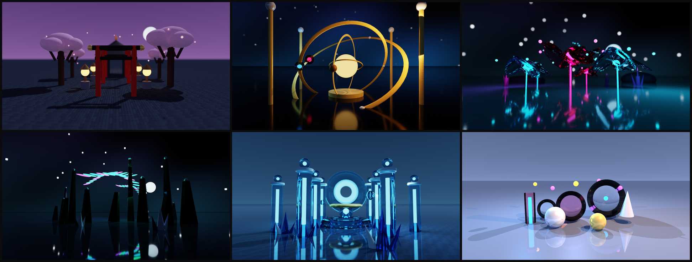
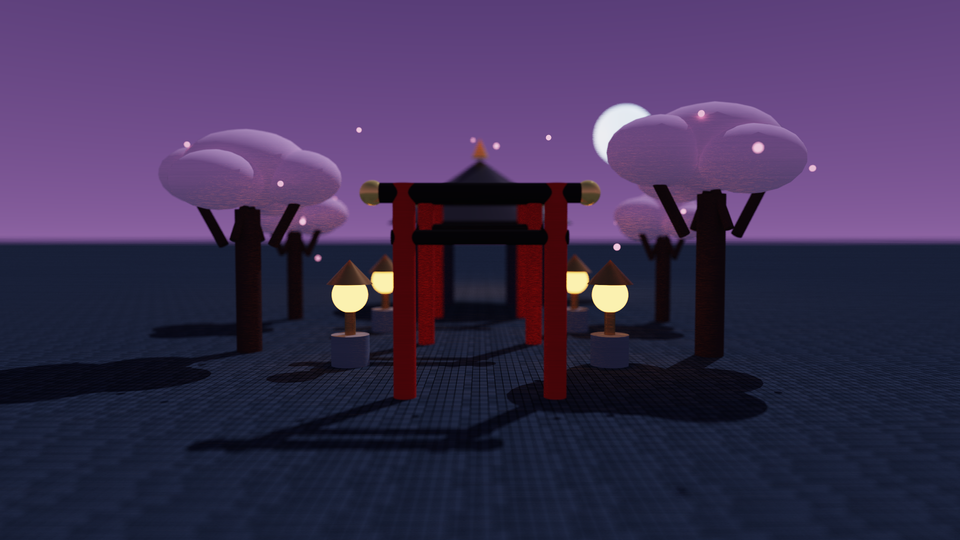
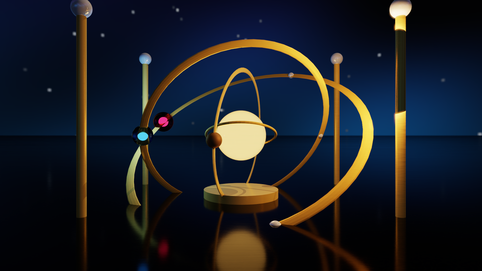
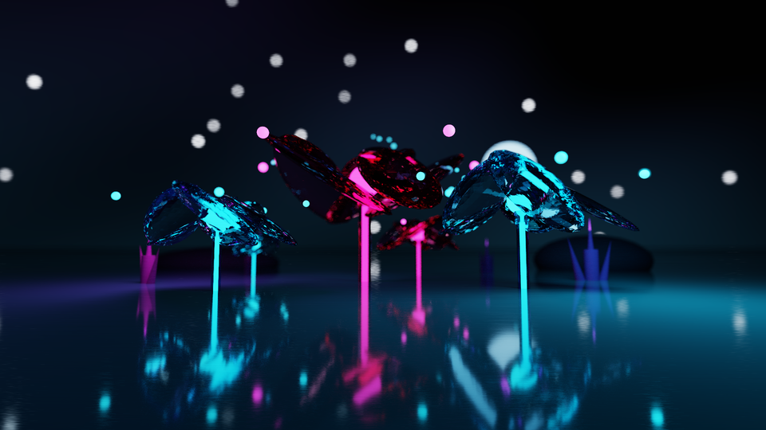
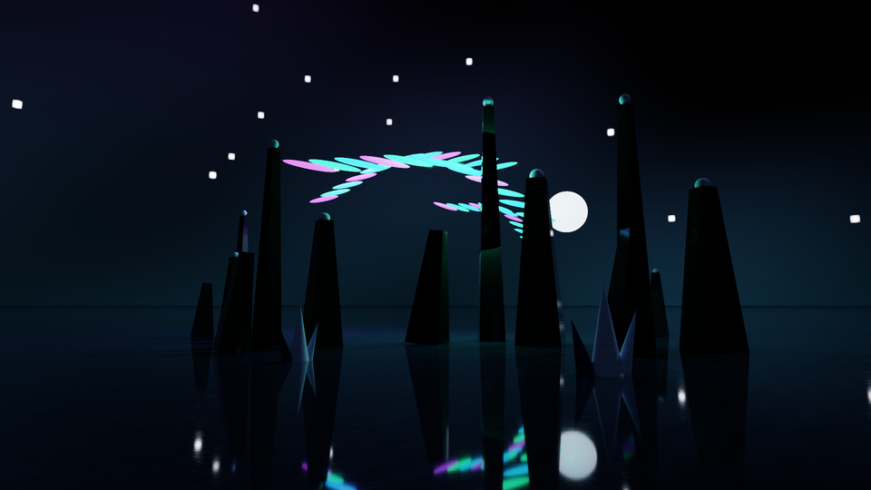
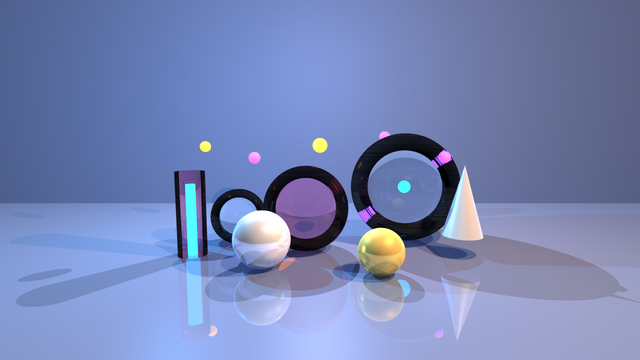
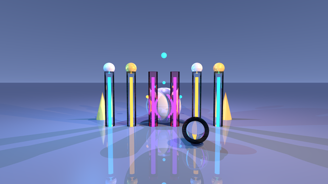
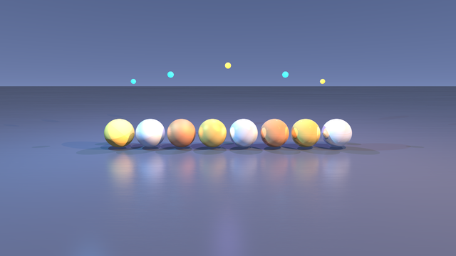
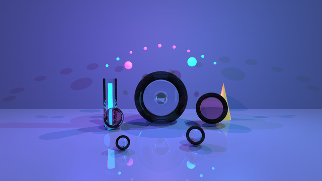
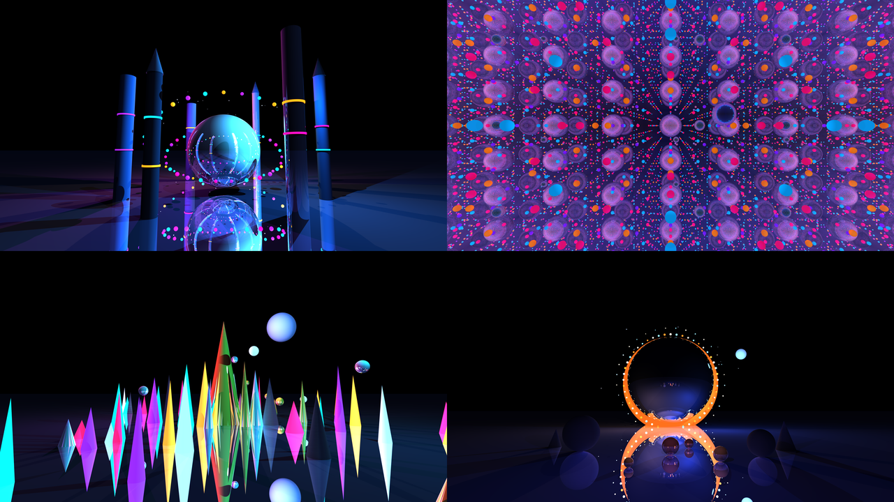

# Ray Tracer

A C++20 ray tracer with a plugin-based architecture, interactive SFML and
GLFW/OpenGL previewers, a multithreaded CPU renderer, and an optional CUDA GPU
renderer.

The project includes a strict libconfig scene parser, a reusable shared core,
runtime-loaded primitives/materials/lights/GUI/renderers, deterministic
camera-animation sequences, and scripts for full-HD and 8K still renders.

[](screenshots/contact.png)

*A curated first look: the five new hero scenes plus the Glass Menagerie.
[See the full gallery](#screenshots).*

## Highlights

- **Renderer plugins** — select `cpu` or `cuda` at runtime with `--renderer`.
- **CPU renderer** — multithreaded path tracer with the full feature set.
- **CUDA renderer** — progressive GPU rendering, full CPU feature parity, and
  static CUDA runtime linkage.
- **Plugin architecture** — primitives, materials, lights, GUI and renderers are
  loaded from `plugins/` at runtime.
- **Strict scene parser** — validates dimensions, normals, lights, camera
  settings and material indices before rendering.
- **Interactive GUI backends** — SFML 3 or GLFW/OpenGL 3.3, with
  camera-relative movement, look controls, FOV zoom, reset and camera locks.
- **Headless CLI** — binary PPM or PNG output, stdout support, configurable
  resolution/samples, exposure and tonemapping.
- **Animation** — keyframed camera, prefab-instance and light timelines,
  deterministic numbered frame sequences, camera motion blur, resumable
  rendering and JSON sequence metadata, with CPU/CUDA playback from the CLI.
- **Video output** — direct MP4/H.264 and WebM/VP9 encoding through FFmpeg,
  with optional simultaneous frame output.
- **Visual pipeline** — exact sRGB output, optional Reinhard/ACES tonemapping,
  and scene background gradients for reflections.
- **Materials** — diffuse, emissive, flat-colour, Fresnel glass and GGX-rough
  metallic surfaces.
- **Scene scale** — a shared binned-SAH BVH accelerates both renderers,
  primitives support declarative transforms, and OBJ meshes use shared triangle
  BVHs with cheap instancing and smooth vertex-normal shading.
- **Depth of field** — world-space lens radius and focus distance, with live
  keyboard focus controls in both interactive backends.
- **Area lights** — solid-angle cone sampling of sphere lights produces
  physically consistent soft shadows in both renderers.
- **Textures** — albedo, roughness, emission and normal maps with UVs on meshes
  and analytic primitives, bilinear filtering and repeat wrapping on CPU and
  CUDA.
- **Primitives** — spheres, planes, cylinders, cones, boxes, disks/rings, OBJ
  meshes and deterministic prefab scatter.
- **OBJ materials** — `usemtl` face groups mapped to scene materials, automatic
  `mtllib`/MTL import with `Kd`/`Ka`/`Ks`/`Ns` and `map_Kd`, plus a per-mesh
  fallback for unmapped groups.
- **HDR environment maps** — equirectangular PPM, PNG, JPG and Radiance `.hdr`
  skies with importance-sampled IBL and MIS; gradient backgrounds remain the
  fallback.
- **Cinematic bloom** — optional HDR bright-pass and separable Gaussian glow
  with matching CPU/CUDA kernels, applied before exposure and tonemapping.
- **Render scripts** — `render_hd.sh` for 1080p stills and `render_8k.sh` for
  8K renders with PNG, 4K, 1080p and contact-sheet conversion.
- **Included scenes** — 37 scenes, from material studies to glass showcases, mesh instancing, depth of field, soft shadows, material maps, boxes/disks, prefab scatter, environment lighting, group transforms, a five-scene hero pack and 8K renders.

## Screenshots

The images below were rendered with the CUDA renderer at 1920×1080 (256
samples), using ACES tone mapping, HDR IBL and tuned bloom. Click any preview
for the full-size PNG.

### Hero scene pack

**Sakura Shrine at Blue Hour** — `sakura_shrine.cfg`  
[](screenshots/hero/sakura_shrine.png)

Prefab torii gates and stone lanterns, grouped cherry-tree transforms, an
icosphere blossom canopy, a tiled stone path, depth of field, and a warm sphere
light behind the shrine. The scene demonstrates prefab instancing with local
materials and lights, plus nested group transforms.

**The Brass Orrery** — `brass_orrery.cfg`  
[](screenshots/hero/brass_orrery.png)

Thin procedural ring meshes, tilted prefab orbit groups, GGX-brushed brass,
chrome moons, sapphire and ruby glass planets, and a layered emissive/glass sun.
It is a compact showcase for mesh instancing, nested transforms, metallic
roughness and dielectric materials.

**Tidal Bloom** — `tidal_bloom.cfg`  
[](screenshots/hero/tidal_bloom.png)

Wide non-uniformly scaled glass petals, glowing stems and petal tips, prefab
blooms, a mirror lagoon, floating spores, a distant moon and an equirectangular
nebula environment. The scene is built almost entirely from prefab instances and
demonstrates group transforms on both geometry and point lights.

**Obsidian Aurora** — `obsidian_aurora.cfg`  
[](screenshots/hero/obsidian_aurora.png)

A black mirror plain, tapered procedural monoliths, frost caps, foreground ice
spires and layered emissive aurora ribbons. It combines a custom OBJ mesh with
environment lighting, large sphere area lights, emitters and reflective metal.

**Frozen Cathedral** — `frozen_cathedral.cfg`  
[](screenshots/hero/frozen_cathedral.png)

A nave of prefab ice pillars with glowing cores and shard bases, a gold and
dielectric altar, a luminous rose window, floating ice orbs, and a cracked-ice
mirror floor. It showcases layered dielectric shells, area lights, textures and
prefab-heavy composition.

### Material and light studies

| Glass Menagerie | Prism Pavilion |
| --- | --- |
| [](screenshots/new-scenes/glass_menagerie.png) | [](screenshots/new-scenes/prism_pavilion.png) |
| **Glass Menagerie** — multiple dielectric IORs, chrome, gold, emissive orbs and a glass column. | **Prism Pavilion** — glass colonnade, glowing cores, chrome orb, neon ring and mirror floor. |

| Roughness Study | Aurora Lens |
| --- | --- |
| [](screenshots/new-scenes/roughness_study.png) | [](screenshots/new-scenes/aurora_lens.png) |
| **Roughness Study** — the same metallic material from perfect mirror to satin GGX roughness. | **Aurora Lens** — a giant glass lens, rose glass, chrome accents and a floating aurora arc. |

### 8K ultra scenes

[](screenshots/8k/contact.png)

Four 7680×4320 scenes rendered at 2048 samples: **Hypernova Cathedral** (chrome
singularity in a cosmic colonnade), **Infinity Mirror** (reflection-heavy neon
corridor), **Crystal Superbloom** (a dense crystal field) and **Solar Eclipse**
(an eclipsed sun with a particle corona over a mirror sea). The full contact
sheet links to the 8K, 4K and 1080p versions in `screenshots/8k/`.

## Requirements

| Dependency | Notes |
| --- | --- |
| CMake | 3.20 minimum. Tested with 4.2.3. |
| C++20 compiler | Tested with GCC 15.2 and Clang 21.1. |
| `libconfig++` | Found through `pkg-config`. |
| SFML 3.0.x | Optional GUI plugin; Graphics, Window and System. Tested with SFML 3.0.2. |
| GLFW 3.3+ | Optional OpenGL GUI plugin. Tested with GLFW 3.4. |
| GLEW 2.x | Optional OpenGL GUI loader. Tested with GLEW 2.2. |
| Threads / `dl` | Standard system libraries. |
| CUDA Toolkit | Optional. Tested with CUDA 13.4. |
| NVIDIA driver | Required for the CUDA renderer. |
| Python 3 + Pillow | Used by the render scripts for PNG and preview conversion. |
| `ffmpeg` | Optional runtime dependency for `--video` output and video tests. |

For Debian/Ubuntu, the package names are typically `build-essential`, `cmake`,
`pkg-config`, `libconfig++-dev`, `libsfml-dev`, `libglfw3-dev` and `libglew-dev`;
make sure `libsfml-dev` provides SFML 3.0.x, or build SFML 3 from source.
`python3-pil` provides Pillow and `ffmpeg` provides the video encoder.

Install the native dependencies with your package manager. SFML and the
OpenGL GUI are optional; each plugin is built only when its dependencies are
available. SFML must be 3.0.x; older SFML 2.x releases are not compatible.
The CUDA renderer builds for compute capability `89` by default (Ada / RTX
4070 Laptop). Set `-DRAYTRACER_CUDA_ARCH=86` (or `86;89`) for other GPUs.

## Build

The project defaults to a Release build. Pass
`-DCMAKE_BUILD_TYPE=Debug` for a debug build.

```bash
cmake -S . -B build
cmake --build build -j"$(nproc)"
ctest --test-dir build --output-on-failure
```

By default the executable is written to the repository root as `./raytracer`,
the shared core library stays in `build/`, and plugins are written to
`plugins/`. For CI or when keeping several build directories, configure with
`-DRAYTRACER_IN_SOURCE_OUTPUT=OFF`; the executable and plugins then stay inside
the build tree:

```bash
cmake -S . -B build -DRAYTRACER_IN_SOURCE_OUTPUT=OFF
cmake --build build -j"$(nproc)"
./build/raytracer --list-renderers
```

Install a self-contained bundle with:

```bash
cmake --install build --prefix /opt/raytracer
```

The installer puts the executable and core library in `bin/`, plugins in
`bin/plugins/`, and scenes in `share/raytracer/scenes/`. Plugin lookup also
honours `RAYTRACER_PLUGIN_DIR` and searches next to the executable.

CUDA is detected automatically:

```bash
# Disable CUDA and build only the CPU renderer
cmake -S . -B build -DRAYTRACER_ENABLE_CUDA=OFF

# Build a headless client without the SFML GUI plugin
cmake -S . -B build -DRAYTRACER_ENABLE_GUI=OFF

# Build without the GLFW/OpenGL GUI plugin
cmake -S . -B build -DRAYTRACER_ENABLE_OPENGL_GUI=OFF

# Point CMake at a specific toolkit
cmake -S . -B build -DCUDAToolkit_ROOT=/usr/local/cuda-13.4

# Target another GPU generation
cmake -S . -B build -DRAYTRACER_CUDA_ARCH=86
```

With the default layout, run `./raytracer` from the repository root so that
`./plugins/` resolves correctly. Isolated builds can run from anywhere; plugin
lookup starts next to the executable.

## Quick start

Render a scene on the CPU:

```bash
./raytracer --path scenes/showcase.cfg --cli \
  --width 1920 --height 1080 --frames 100 \
  --output showcase.ppm
```

Render the same scene with CUDA:

```bash
./raytracer --path scenes/showcase.cfg --cli --renderer cuda \
  --width 1920 --height 1080 --samples 1000 \
  --output showcase.png
```

Render a deterministic camera animation as a PNG sequence:

```bash
mkdir -p frames
./raytracer --path scenes/brass_orrery.cfg --cli --renderer cuda \
  --width 1280 --height 720 --samples 64 --animation \
  --output 'frames/orrery-%04d.png'

ffmpeg -framerate 24 -i 'frames/orrery-%04d.png' \
  -c:v libx264 -pix_fmt yuv420p orrery.mp4
```

`--start-frame`, `--end-frame` and `--fps` select a sub-range and override the
scene frame rate. Add `--shutter-angle 180 --shutter-samples 8` for camera
motion blur. Scenes can also animate named prefab instances and lights through
the `animation` block; see [docs/scene-format.md](docs/scene-format.md). `--resume`
skips completed frames, and `--validate` prints the resolved frame range,
output pattern and animated targets without rendering. Animation is CLI-only;
still renders of the same scene are unchanged.

Encode the animation directly to a video file:

```bash
./raytracer --path scenes/brass_orrery.cfg --cli --renderer cuda \
  --width 1920 --height 1080 --samples 128 --animation \
  --shutter-angle 180 --shutter-samples 8 \
  --video orrery.mp4
```

FFmpeg must be installed (`sudo apt install ffmpeg` on Debian/Ubuntu). Video
output is video-only by default; add `--keep-frames` or `--output` to also write
the numbered frames. WebM/VP9 is selected by the `.webm` extension.

Open the interactive SFML window:

```bash
./raytracer --path scenes/showcase.cfg --gui sfml --renderer cuda
```

Or use the raw GLFW/OpenGL window:

```bash
./raytracer --path scenes/showcase.cfg --gui opengl --renderer cuda
```

`--sfml` remains an alias for `--gui sfml`.

GUI controls: `WASD` moves relative to the current view, `Q/E` moves up/down,
arrow keys or `IJKL` look around, `+`/`-` zooms, `R` restores the starting pose,
`X`/`C` toggle camera locks, and `Esc` quits. `Space` pauses/resumes rendering,
`P` saves the current frame as `raytracer-<timestamp>.ppm`, and `[`/`]`
decrease/increase exposure live. `,`/`.` change the lens radius and `;`/`'`
pull/push the focus distance. `R` also restores the initial lens and focus.
The window title shows progress, elapsed time, exposure, lens/focus, and pause
state.

List the renderer plugins:

```bash
./raytracer --list-renderers
./raytracer --list-guis
```

Example output:

```text
Available renderers:
  cpu  - Multithreaded CPU renderer (default) [available]
  cuda - CUDA GPU renderer [available]

Available GUI backends:
  sfml - SFML 3 window
  opengl - GLFW/OpenGL 3.3 window
```

## CLI

```text
Usage: ./raytracer --path <scene.cfg> --cli|--gui sfml|opengl
       [--renderer cpu|cuda] [--width W] [--height H] [--samples N] [--frames N]
       [--threads N] [--seed N] [--device N]
       [--lens-radius R] [--focus-distance D] [--exposure E]
       [--tonemap none|reinhard|aces]
       [--animation [--start-frame N] [--end-frame N] [--fps F]
        [--shutter-angle A] [--shutter-samples N] [--resume] [--validate]]
       [--video out.mp4|out.webm [--video-codec h264|vp9] [--video-crf N]
        [--video-preset P] [--video-bitrate R] [--keep-frames]]
       [--output out.ppm|out.png|frame-%04d.png]
       [--list-renderers] [--list-guis]
```

| Option | Description | Default |
| --- | --- | --- |
| `--path <file>` | Scene configuration file. | required |
| `--cli` | Render headlessly. | |
| `--gui <backend>` | Interactive backend: `sfml` or `opengl`. | `sfml` |
| `--sfml` | Alias for `--gui sfml`. | |
| `--renderer <name>` | Renderer plugin: `cpu` or `cuda`. Case-insensitive. | `cpu` |
| `--list-renderers` | List renderers and exit. | |
| `--width <N>` | Render width and window width. Must be positive. | `960` |
| `--height <N>` | Render height and window height. Must be positive. | `540` |
| `--samples <N>` | Samples per pixel. Higher is cleaner and slower. | `10` |
| `--frames <N>` | Backward-compatible alias for `--samples`. | `10` |
| `--threads <N>` | CPU worker threads; `0` means automatic. | `0` |
| `--seed <N>` | Sampling seed offset for reproducible renders. | `0` |
| `--device <N>` | CUDA device index. | `0` |
| `--lens-radius <R>` | Camera lens disk radius; `0` is a pinhole. | scene value |
| `--focus-distance <D>` | Distance from the eye to the focus plane. | scene value |
| `--exposure <E>` | Linear exposure before tonemapping. | `1.0` |
| `--tonemap <mode>` | `none`, `reinhard`, or `aces`. | `none` |
| `--animation` | Render the scene camera animation. | off |
| `--start-frame <N>` | First animation frame, inclusive. | `0` |
| `--end-frame <N>` | Last animation frame, inclusive. | last frame |
| `--fps <F>` | Override the scene animation frame rate. | scene value |
| `--shutter-angle <A>` | Camera shutter opening in degrees; `0` disables blur. | scene value |
| `--shutter-samples <N>` | Deterministic motion-blur subframe count. | scene value |
| `--resume` | Skip animation frames that already exist. | off |
| `--validate` | Parse and print the resolved render settings, then exit. | off |
| `--video <file>` | Encode the animation to MP4/MOV/MKV/WebM. | off |
| `--video-codec <name>` | `h264` or `vp9`. | by container |
| `--video-crf <N>` | Quality target; H.264 `0–51`, VP9 `0–63`. | `18` / `32` |
| `--video-preset <name>` | H.264 speed/quality preset. | `medium` |
| `--video-bitrate <rate>` | Target bitrate such as `8M`; overrides CRF. | unset |
| `--keep-frames` | Also write numbered frames with `--video`. | off |
| `--output <file>` | Output PPM/PNG path or animation frame pattern. | stdout; `frame-%04d.ppm` for animation |
| `--list-renderers` | List renderer plugins and exit. | |
| `--list-guis` | List GUI backends and exit. | |
| `--help`, `-h` | Print usage and exit. | |

Important details:

- `--samples` (and the legacy `--frames`) is the number of **samples per
  pixel**, not an animation frame count. Use `--start-frame`/`--end-frame` to
  select animation frames.
- The output format follows the extension: `.ppm` is binary `P6` and `.png` is
  8-bit RGBA. PPM keeps 8K images around 95 MB instead of several hundred MB of
  ASCII.
- In CLI mode, omitting `--output` writes a still PPM to standard output.
  Animated renders without `--video` default to `frame-%04d.ppm`; video-only
  renders write no frame files.
- In GUI mode, no file is written unless `--output` is provided. Animation is
  rejected in GUI mode.
- Animation frames are written atomically and produce a JSON metadata sidecar.
  Use `--resume` to complete an interrupted sequence and `--validate` to check
  the resolved settings first.
- `--video` streams frames to an FFmpeg subprocess and writes a temporary file
  that is renamed on success. `--resume` is not supported with video; use a
  frame sequence for resumable renders.
- Errors exit with status `1` and do not write an image.
- `--list-renderers` and `--help` exit with status `0`.

See [docs/cli.md](docs/cli.md) for the full CLI reference and examples.

## Renderers

The default `cpu` renderer is a multithreaded path tracer that walks the
plugin-backed scene graph directly.

The optional `cuda` renderer flattens the scene through `SceneSnapshot`, uploads
it to the GPU, and implements the same intersections, materials, lights, shadow
rays and bounce rules. It uses a seeded PCG sampler and static `cudart`.

CUDA rendering is progressive in both GUI backends: samples are rendered in
small batches while window events are pumped continuously, so camera movement is
detected during a heavy kernel instead of freezing the window.

Representative performance on an RTX 4070 Laptop:

| Workload | CPU | CUDA |
| --- | ---: | ---: |
| Chrome Singularity, 1920×1080, 140 samples | ~10 minutes | ~2 seconds |
| Chrome Singularity, 1920×1080, 1000 samples | — | ~3 seconds |
| All four 8K ultra scenes, 7680×4320, 2048 samples | — | ~36 minutes |

See [docs/performance.md](docs/performance.md) for BVH benchmark methodology and
numbers. See [docs/renderers.md](docs/renderers.md) for the renderer interface, plugin
architecture and CUDA build details.

## Scenes and render scripts

### Starter scenes

| Scene | Description |
| --- | --- |
| `config.cfg` | Small introductory scene. |
| `primitives.cfg` | Spheres, a cylinder, a cone and a plane. |
| `materials.cfg` | Diffuse, metallic, emissive and flat materials. |
| `reflections.cfg` | Metallic mirror floor and reflective spheres. |
| `lighting.cfg` | Coloured point lights and emissive bulbs. |
| `orbits.cfg` | Emissive sun, planets and a starfield. |
| `showcase.cfg` | All material families and light types together. |
| `transforms.cfg` | Translated, rotated and non-uniformly scaled primitives. |
| `meshes.cfg` | Instanced, smooth-shaded OBJ icospheres and a torus with shared geometry. |
| `depth_of_field.cfg` | Spheres at several depths with a focused middle plane. |
| `soft_shadows.cfg` | Two sphere area lights over a floor and three spheres. |
| `textures.cfg` | Checker PPM textures on a plane, primitives and a mesh. |
| `material_maps.cfg` | Roughness, normal and emission maps on metal, stone and an emissive sign. |
| `primitives_extra.cfg` | Axis-aligned boxes and metal/glass disks/rings. |
| `scatter_field.cfg` | 180 deterministically scattered emissive spores. |
| `obj_materials.cfg` | A multi-material OBJ cube with `usemtl` groups and a fallback. |
| `environment.cfg` | An equirectangular sky used for reflections and IBL. |
| `mtl_materials.cfg` | Automatic OBJ/MTL material import, including a textured face. |
| `group_transform.cfg` | A nested scene of spheres and a point light transformed as a group. |
| `prefabs.cfg` | One lamp prefab instantiated three times with different transforms. |

### HD hero scenes

| Scene | Description |
| --- | --- |
| `neon_district.cfg` | Stylized neon boulevard with light-banded towers. |
| `crystal_garden.cfg` | Crystal spires, metallic shards and floating orbs. |
| `chrome_singularity.cfg` | Chrome world with a tilted accretion ring. |
| `solar_bloom.cfg` | Amber sun over a mirror sea. |
| `sakura_shrine.cfg` | Blue-hour shrine with torii, cherry trees and warm lanterns; camera dolly and light pulse. |
| `brass_orrery.cfg` | Brass orbit rings, glass planets and a glowing sun; camera orbit, rotating rings and sun pulse. |
| `tidal_bloom.cfg` | Bioluminescent glass flowers over a lagoon; camera glide, bobbing blooms and pulsing lights. |
| `obsidian_aurora.cfg` | Monolith silhouettes under luminous aurora ribbons. |
| `frozen_cathedral.cfg` | Ice pillars, a glowing altar and a reflective frozen nave. |

### 8K ultra scenes

| Scene | Description |
| --- | --- |
| `hypernova_cathedral.cfg` | Chrome singularity inside a cosmic colonnade. |
| `infinity_mirror.cfg` | Mirrored corridor of repeating neon gates. |
| `crystal_superbloom.cfg` | Dense field of giant crystal spires. |
| `solar_eclipse.cfg` | Eclipse with a particle corona over a mirror sea. |

### Animations

`sakura_shrine`, `brass_orrery` and `tidal_bloom` include `animation` blocks
that move the camera, named prefab instances and light intensities. Render a
numbered sequence with `--animation`:

```bash
mkdir -p frames
./raytracer --path scenes/sakura_shrine.cfg --cli --renderer cuda \
  --width 1280 --height 720 --samples 64 --animation \
  --output 'frames/sakura-%04d.png'
```

Or use the helper, which also assembles an MP4 when `ffmpeg` is available:

```bash
SCENE=sakura_shrine SAMPLES=64 WIDTH=1280 HEIGHT=720 \
  ./scenes/render_animation.sh
FFMPEG=1 ./scenes/render_animation.sh brass_orrery
```

Render all HD hero scenes:

```bash
./scenes/render_hd.sh
RENDERER=cuda FRAMES=1000 ./scenes/render_hd.sh
```

The new scene pack is tuned for ACES with a slightly raised exposure:

```bash
./raytracer --path scenes/sakura_shrine.cfg --cli --renderer cuda \
  --width 1920 --height 1080 --frames 256 --tonemap aces --exposure 1.25 \
  --bloom --bloom-threshold 1.5 --bloom-intensity 0.20 --bloom-radius 6 \
  --output sakura_shrine.ppm
./raytracer --path scenes/brass_orrery.cfg --cli --renderer cuda \
  --width 1920 --height 1080 --frames 256 --tonemap aces --exposure 0.85 \
  --bloom --bloom-threshold 1.5 --bloom-intensity 0.35 --bloom-radius 8 \
  --output brass_orrery.ppm
./raytracer --path scenes/tidal_bloom.cfg --cli --renderer cuda \
  --width 1920 --height 1080 --frames 320 --tonemap aces --exposure 1.15 \
  --bloom --bloom-threshold 2.5 --bloom-intensity 0.20 --bloom-radius 6 \
  --output tidal_bloom.ppm
./raytracer --path scenes/frozen_cathedral.cfg --cli --renderer cuda \
  --width 1920 --height 1080 --frames 256 --tonemap aces --exposure 0.90 \
  --bloom --bloom-threshold 2.0 --bloom-intensity 0.20 --bloom-radius 6 \
  --output frozen_cathedral.ppm
./raytracer --path scenes/obsidian_aurora.cfg --cli --renderer cuda \
  --width 7680 --height 4320 --frames 2048 --tonemap aces --exposure 1.15 \
  --bloom --bloom-threshold 3.0 --bloom-intensity 0.25 --bloom-radius 6 \
  --output obsidian_aurora.ppm
```

Render all 8K ultra scenes:

```bash
./scenes/render_8k.sh
FRAMES=4096 ./scenes/render_8k.sh solar_eclipse
```

Script environment variables:

| Variable | `render_hd.sh` | `render_8k.sh` |
| --- | --- | --- |
| `WIDTH` | `1920` | `7680` |
| `HEIGHT` | `1080` | `4320` |
| `FRAMES` | `140` | `2048` |
| `RENDERER` | `cpu` | `cuda` |
| `OUT_DIR` | `screenshots/hd` for CPU, `screenshots/hd-<renderer>` otherwise | `screenshots/8k` |
| `CONVERT` | — | `1` (set `0` to skip PNG conversion) |

The 8K script writes full-size PPM/PNG, 4K and 1080p previews, and a
`contact.png` sheet.

The scene format is documented in [docs/scene-format.md](docs/scene-format.md)
and [scenes/README.md](scenes/README.md).

## Architecture

```text
raytracer
  └── libraytracer_core.so
        ├── Camera, Scene, SceneBuilder
        ├── libconfig parser
        ├── Factory / DLManager
        ├── renderer interfaces and helpers
        └── SceneSnapshot

plugins/
  ├── raytracer_renderer_cpu.so
  ├── raytracer_renderer_cuda.so
  ├── raytracer_sphere.so / plane / cylinder / cone
  ├── raytracer_material_*.so
  ├── raytracer_light_*.so
  ├── raytracer_transformation_*.so
  └── raytracer_gui.so
```

The executable only parses arguments, builds the scene and selects a renderer.
Rendering and scene components are shared libraries loaded at runtime. All
plugins link against `raytracer_core`, so core types have one definition and one
set of RTTI symbols across the process.

Key directories:

| Path | Contents |
| --- | --- |
| `src/` | Executable entry point and application flow. |
| `src/render/` | Renderer registry, animation timeline, PPM/PNG/video output, camera controller, scene snapshot. |
| `src/plugins/renderers/` | CPU and CUDA renderer plugins. |
| `src/plugins/primitives/` | Sphere, plane, cylinder and cone plugins. |
| `src/plugins/materials/` | Material plugins. |
| `src/plugins/lights/` | Ambient, directional and point light plugins. |
| `src/plugins/parser/` | Scene parser. |
| `include/plugins/renderers/` | Renderer, snapshot and helper interfaces. |
| `scenes/` | Scene files, render scripts and scene documentation. |
| `screenshots/` | Curated gallery, hero renders, material studies and 8K previews. |

See [docs/developer.md](docs/developer.md) for the developer guide and
[docs/renderers.md](docs/renderers.md) for the renderer plugin API.

## Troubleshooting

**`cannot open shared object file: ./plugins/...`**
Run `./raytracer` from the repository root after building. The executable loads
plugins from `./plugins/`.

**`Renderer 'cuda' is unavailable`**
The CUDA plugin was not built, the NVIDIA driver is unavailable, or no CUDA device
was detected. Check `./raytracer --list-renderers`, then rebuild with CUDA
enabled or use `--renderer cpu`.

**CUDA kernel image error on another GPU**
The CUDA plugin is compiled for compute capability `89` by default. Reconfigure
with `-DRAYTRACER_CUDA_ARCH=<cc>` and rebuild for the target GPU.

**`--output /nonexistent/...` exits with an error**
The output directory must exist and be writable. This is intentional: the
program does not create parent directories.

**PPM opens incorrectly in an old image tool**
PPM output is binary `P6`. Pillow and ImageMagick handle it correctly. The render
scripts convert to PNG if needed.

**8K rendering is slow / uses a lot of disk**
8K is intended for `--cli`. Use the 4K or 1080p previews for inspection. The
Infinity Mirror scene is the most expensive because of its nested reflections.

**GUI window issues**
SFML needs SFML 3.0.x; the OpenGL backend needs GLFW 3.3+, GLEW and an
X11/GLX-capable display. Use `--gui sfml` or `--gui opengl` to choose, and
`--cli` for headless rendering. `--list-renderers` does not test GUI plugins.

## Development

Before committing, run the project hook:

```bash
./pre-commit.sh
```

See [docs/developer.md](docs/developer.md) for the architecture, plugin
guidelines, coding conventions and verification commands.

## License

No license file is currently included in this repository.
