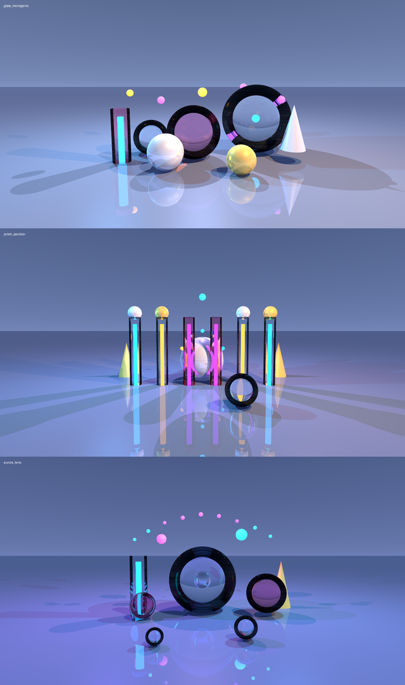

# Raytracer test scenes

Each file is a complete scene for the parser. See
[../README.md](../README.md) for building and running the project,
[../docs/cli.md](../docs/cli.md) for the complete command-line reference, and
[../docs/scene-format.md](../docs/scene-format.md) for the full scene
configuration reference.

Run one interactively with:

```bash
./raytracer --path scenes/<name>.cfg --gui sfml
./raytracer --path scenes/<name>.cfg --gui opengl
```

Or render it headlessly without a display server:

```bash
./raytracer --path scenes/<name>.cfg --cli --width 960 --height 540 --frames 30 --output render.ppm
```

Useful options:

- `--cli` — render without opening a window. The PPM image is written to
  `--output`, or to standard output when `--output` is omitted.
- `--gui sfml|opengl` — open an interactive window. `--sfml` is an alias for
  `--gui sfml`. A PPM is only written when `--output` is given.
- `--frames N` — samples per pixel (higher = cleaner, slower; default 10).
  Use 30+ for quick previews and 100+ for final stills.
- `--output out.ppm` — write the rendered image as a binary P6 PPM.
- `--width/--height` — render resolution, GUI window size and PPM size
  (default 960x540).
- `--renderer cpu|cuda` — choose the renderer plugin (default `cpu`).
- `--list-renderers` — list the available renderer plugins and their status.
- `--help` — print usage and exit.

While the window is open: `WASD` moves relative to the current view, `Q/E` moves
up/down, arrow keys or `IJKL` look around, `+/-` zooms, `R` restores the starting
pose, `X` locks the look-at point, `C` locks the camera position, and `Esc` quits.
`Space` pauses/resumes, `P` saves a screenshot, `[`/`]` changes exposure,
`,`/`.` changes the lens radius, and `;`/`'` pulls/pushes focus.
Resizing the SFML window stretches the rendered image; the OpenGL backend
letterboxes it to preserve aspect ratio.

| Scene | What it shows |
| --- | --- |
| `showcase.cfg` | Diffuse, metallic, emissive and flat materials together, three light types |
| `primitives.cfg` | Spheres, a cylinder, a cone and an infinite plane |
| `materials.cfg` | The four material models side by side on identical spheres |
| `reflections.cfg` | A metallic mirror floor with coloured metallic spheres |
| `lighting.cfg` | Red, green and blue point lights plus visible emissive bulbs |
| `orbits.cfg` | A small planetary scene with an emissive sun, planets and a starfield |
| `neon_district.cfg` | A stylized neon boulevard with light-banded towers and a glowing amber orb |
| `crystal_garden.cfg` | Glowing crystal spires, metallic shards and floating orbs on a mirrored floor |
| `chrome_singularity.cfg` | A chrome world wrapped in a tilted accretion ring and a starfield |
| `solar_bloom.cfg` | A huge amber sun rising over a mirror sea with silhouetted spheres |
| `hypernova_cathedral.cfg` | A chrome singularity ringed by neon particles inside a cosmic colonnade |
| `infinity_mirror.cfg` | A mirrored corridor filled with repeating neon gates and endless reflections |
| `crystal_superbloom.cfg` | A vast field of giant crystal spires, floating orbs and a distant moon |
| `solar_eclipse.cfg` | A giant amber sun eclipsed by a dark sphere above a mirror sea |
| `glass_menagerie.cfg` | Dielectric spheres and a glass column with chrome, gold and emissive orbs |
| `prism_pavilion.cfg` | A glass colonnade with glowing cores, a chrome orb and a neon ring |
| `aurora_lens.cfg` | A giant glass lens, rose glass and a floating aurora arc |
| `roughness_study.cfg` | Metal spheres from perfect mirror to satin roughness |
| `transforms.cfg` | Translate/rotate/scale transforms on spheres, cylinders, cones and planes |
| `meshes.cfg` | Instanced OBJ icospheres and a torus with shared geometry |
| `depth_of_field.cfg` | Five spheres at increasing depths with a focused middle plane |

## Material showcase renders

The glass scenes and roughness study were rendered at `1280×720` with 256 CUDA
samples:

[](../screenshots/new-scenes/contact.png)

Full-size previews and a contact sheet are in
[`screenshots/new-scenes/`](../screenshots/new-scenes/).

## Full HD renders

`neon_district`, `crystal_garden`, `chrome_singularity` and `solar_bloom` are
composed for 16:9. `scenes/render_hd.sh` renders them at `1920x1080` with 140
frames by default. CPU images go to `screenshots/hd/`; non-CPU renderers go to
`screenshots/hd-<renderer>/` unless `OUT_DIR` is set explicitly.

```bash
./scenes/render_hd.sh
FRAMES=240 ./scenes/render_hd.sh solar_bloom
RENDERER=cuda FRAMES=240 ./scenes/render_hd.sh solar_bloom
```

Set `WIDTH`, `HEIGHT`, `FRAMES`, `RENDERER` or `OUT_DIR` in the environment to
override the defaults.

## 8K renders

The four ultra scenes are composed for 8K:

```bash
./scenes/render_8k.sh
FRAMES=4096 ./scenes/render_8k.sh solar_eclipse
```

The script defaults to `7680x4320`, `2048` frames and the `cuda` renderer. It
writes binary PPM images and converts them to full-size PNGs plus 4K and 1080p
previews in `screenshots/8k/`. A `contact.png` sheet is also created.

Use `FRAMES=4096` or `FRAMES=8192` for even longer passes. The mirrored
Infinity Mirror scene is the most expensive because of its many reflections.

8K rendering is intended for `--cli`; use the 4K or 1080p previews to inspect
the images without loading the full-resolution files.

## Renderers

Rendering is provided by plugins. The default `cpu` renderer is the
multithreaded CPU path tracer. `cuda` is the GPU renderer; it is available when
the project is built with CUDA support. CUDA renders the same scene, lighting
and camera controls as the CPU renderer and is much faster.

```bash
./raytracer --path scenes/showcase.cfg --cli --renderer cpu
./raytracer --path scenes/showcase.cfg --cli --renderer cuda
./raytracer --list-renderers
```

The CUDA versions of the four hero scenes are in `screenshots/hd-cuda/`
(rendered with 1000 frames); the CPU versions remain in `screenshots/hd/`.
CUDA is fast enough that `FRAMES=1000` is practical for very clean 1080p stills.

## Scene format

The full reference is in [../docs/scene-format.md](../docs/scene-format.md).
The short version:

- **Materials** (`materials`): `diffuse` (`ambientReflection`, `diffuseReflection`,
  `color`), `metallic` (`color`), `emissive` (`intensity`, `color`,
  `emissionColor`) and `flatColor` (`color`).
- **Primitives** (`primitives`): `spheres` (`r`, `position`, `material`),
  `planes` (`normal`, `position`, `material`), `cylinders` (`r`, `center` =
  bottom cap, `height`, `material`) and `cones` (`r`, `center` = apex, `h`,
  `material`).
- **Lights** (`lights`): `ambient` (`intensity`, `color`), `directional`
  (`position` = direction towards the light, `intensity`, `color`) and `point`
  (a list of `position`, `intensity`, `color`, `attenuation`).
- **Nested scenes** (`scene`): a `scene` block inside `primitives` is merged
  into the parent scene. Its materials are appended to the parent's material
  list, its primitive material indices are shifted to match, and its lights
  are added to the parent's lights.

Materials are referenced by their index in the `materials` group, starting at 0.
The camera's `rotation` field is the point the camera looks at.

Point lights use inverse attenuation:

```text
intensity / (constant + linear * distance + quadratic * distance^2)
```

The `attenuation` block is required and must contain `constant`, `linear` and
`quadratic` values.

The parser is strict: a missing or mistyped setting, an unknown material type,
a non-positive sphere/cylinder/cone radius or height, a zero plane normal or
light direction, a field of view outside `(0, 180)`, a camera position equal to
its look-at point, or an out-of-range material index prints an error and the
program exits with a non-zero status without writing an image. `metallic` also
accepts the legacy spelling `metalic`. Dielectrics support a positive `ior`
value (default `1.5`).
